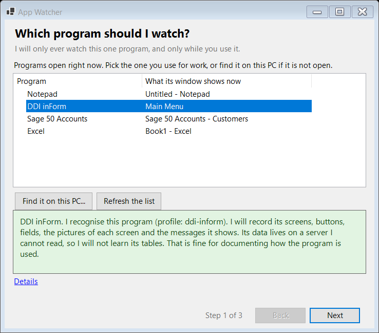
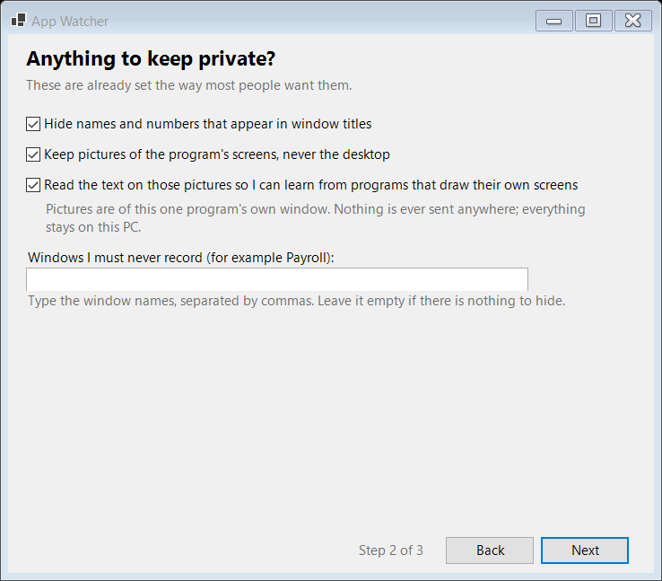
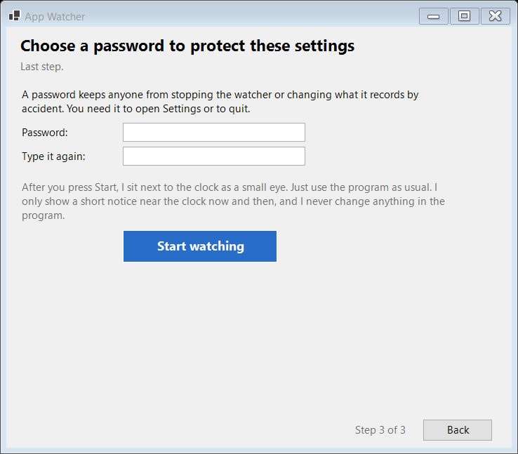
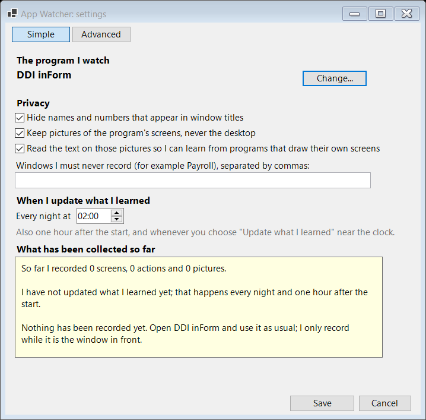
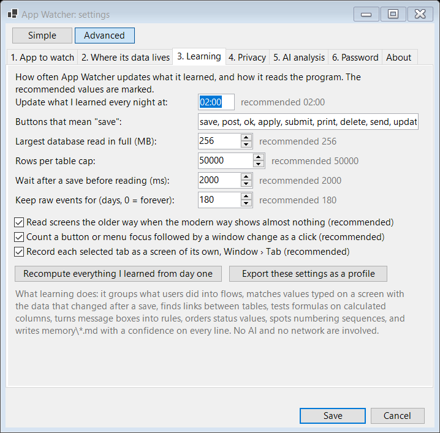

# App Watcher

[](https://github.com/raj0319/app-watcher/releases/latest)
[](LICENSE)


**Learn how any Windows business app works, just by watching people use it.**

Most companies run on desktop software that nobody fully documents any more: an ERP, a billing system, an
in-house tool. The knowledge lives in people's heads. App Watcher sits in the tray, watches **one** program
while your team works as usual, and writes down how it works: its screens and fields, what the program fills
in by itself, the calculations it does, its messages and rules, and the everyday flows, step by step.

It is **read-only by design**: it never clicks or types in the program, installs no keyboard or mouse hook,
never reads password boxes, and keeps everything on the PC.

### Status: early beta

App Watcher is an early beta. It has been tested in depth on one real distribution ERP, and on test runs with
WinForms, WPF, web-page, Qt, classic Win32, Excel and PowerShell ISE programs. Please tell us how it works on
your program with the **Did it work on your app?** form: [open the form](https://github.com/raj0319/app-watcher/issues/new/choose).

### What it writes, for example

From a few minutes of normal use of a small order-entry program (`memory\logic.md`, test data):

```text
## Screen: Sample Web ERP
- Filled in by the program:
  - Typing Customer code fills Name (seen 2× of 3)
  - Typing Unit price fills Line total (seen 4× of 4)
- Calculations:
  - Line total = Quantity × Unit price (seen 12× of 12)
- Rules and messages:
  - on OK: "Customer code must have at least # characters." (seen 1x)
```

Every line says how often it was seen and which evidence file proves it. Typed values never reach these files;
only names, shapes (`#`, `A`, `a`) and counts do.

### Who it is for

- **Teams replacing or migrating a legacy app**: get the screens, fields, rules and flows before the last expert leaves.
- **ERP consultants and business analysts**: document a client's real way of working in days, not weeks of interviews.
- **IT leads who inherited software** with no documentation.
- **Developers rebuilding an app** with an AI coding agent: the export is a blueprint with stable ids and evidence.
- **Process-mining users**: the export includes an IEEE XES event log for PM4Py, ProM or Disco.

### How it was proven

| Test | Result |
|---|---|
| A real distribution ERP in daily use (WinForms, MDI documents, grids, lookups) | 26 of 26 checks at 100% in each of the last 5 driven rounds (41 rounds in all) |
| A web-page app (WebView2) | 7 of 7 checks; `Line total = Quantity × Unit price` learned 12× of 12 |
| A WPF app | 6 of 6 checks, including grids whose cells hold their own text boxes |
| A five-person office, 30 working days (generated) | 328,796 events; full rebuild 9.3 s, one more day 3.4 s |
| Idle cost | about 51 MB private memory, 0% CPU when the app is not in front |

### Quick start (5 minutes)

1. Download `AppWatcher-<version>-win-x64.zip` from the [latest release](https://github.com/raj0319/app-watcher/releases/latest) and unzip it.
2. In that folder, run:

   ```powershell
   powershell -ExecutionPolicy Bypass -File install.ps1
   ```

3. Answer the three questions (which program, anything private, a password) and use the program as usual.
   The next morning, open the folder from the tray icon and read `memory\logic.md`.

**Give it a day.** The useful part (`memory\logic.md`) appears after the first hour and grows overnight.
A five-minute try shows little.

#### Windows says it protected your PC

The program is not code-signed yet, so Windows SmartScreen may warn you the first time you run it. Click
**More info**, then **Run anyway**, but only if you downloaded it from the official
[GitHub releases page](https://github.com/raj0319/app-watcher/releases/latest). You can check the download
against the SHA-256 shown in the release notes:

```powershell
Get-FileHash AppWatcher-<version>-win-x64.zip
```

Antivirus programs may also flag it, because it reads another program's screen and starts at login. It never
writes to that program, installs no keyboard or mouse hook, and makes no network calls. Code signing is planned.

Details of each step, the settings and the honest limits follow below.

## What you get

After a few days of normal work, the folder `C:\ProgramData\AppWatcher\data\<app-name>\memory\` holds
seven living documents, rewritten every night:

| File | What it says |
|---|---|
| `data-model.md` | the tables and columns the app saves to, the type of each column, which screen field fills it, how tables link, the backends found (server, port, database), and the exact SQL statements seen when SQL capture is on |
| `screens.md` | every window and tab document seen, its fields (with how often each was typed into and what kind of value goes in), its buttons and shortcuts, where it is reached from, which menu item opens it, and which tables it writes |
| `rules.md` | validation messages (which field, which kind of value, which message), messages after a button or menu, calculated columns with the formula that fits and its exceptions, numbering sequences |
| `flows.md` | status flows (for example open → paid → shipped) with rare and not-allowed transitions, user flows with the presses and typed fields on each step, and a directly-follows navigation graph (Mermaid, renders on GitHub) |
| `architecture.md` | the toolkit and backends seen from the outside, modules (screens grouped by the tables they share) and an honest "seen vs inferred" count |
| `logic.md` | what a trainee would know after sitting next to the users: per screen, how you get there, what people type, what the program fills in by itself ("typing Customer code fills Customer name"), the calculations it does on screen ("Line total = Quantity × Unit price × (1 − Discount % / 100)"), what each button leads to, the hover tips, the rules, what nobody used yet, and the questions to ask an experienced user. `logic.json` holds the same for a program or an AI |
| `health.md` | events per day, presses seen, pictures and OCR pages, how many saves produced a data diff, how many fields are mapped, what the collector could not do, and what would improve accuracy |

Every line carries a confidence: `seen 12×` means it was observed twelve times; `candidate` means fewer
than three distinct observations; `inferred` means the structure suggests it but nobody proved it.
Every line also names the evidence file to open. `changelog.md` lists what changed since the last learn.

The memory files never contain values that users typed. They contain names, shapes and counts. Window
titles have their quoted parts masked ("Customer - 0002776 "Nate Test"" becomes "Customer - # "…"").

Next to the memory: `screens\<title>.md` with the control tree of every screen and `screens\shots\<screen>\`,
one picture per state of that screen with an index saying which action led to it, so a person or an AI can
compare the old app and the new one state by state.

## Try it first

[docs/demo-test.md](docs/demo-test.md) is a 30-minute test on one PC: install, use the app, learn,
export, send the folder for analysis, uninstall.

## Install (five minutes)

You need a Windows 10 or 11 PC where the app to watch is used.

1. Get `AppWatcher.exe`. Either download the zip from the [releases](https://github.com/raj0319/app-watcher/releases)
   of this repository (the exe and the install scripts, side by side), or build it yourself
   (install the .NET 8 SDK, then run `scripts\publish.ps1`; the exe appears in `publish\`).
2. Open PowerShell in the unzipped folder and run `install.ps1` (in a clone of this repository: `scripts\install.ps1`):

```powershell
powershell -ExecutionPolicy Bypass -File install.ps1
```

   This copies the program to your user folder, makes it start at login, and starts it now.
   Add `-ScheduledTask` if your IT prefers a scheduled task over the Run key.
3. A small window asks three questions, one per step, with **Back** and **Next**. Everything else is
   already decided for you, set to "collect everything that is safe and stays on this PC".

   **Step 1. Which program should I watch?** The programs open right now, with their icons and the names
   you know them by. Pick the one you use for work, or press **Find it on this PC...** if it is not open.
   A green box then says in plain words what I recognised and what I will learn. The technical facts
   (toolkit, profile, servers) are behind **Details**; you do not need them.

   

   **Step 2. Anything to keep private?** Three choices, all already ticked: hide names and numbers that
   appear in window titles; keep pictures of the program's screens, never the desktop; read the text on
   those pictures. Below them, type the windows I must never record (for example Payroll), or leave it empty.

   

   **Step 3. Choose a password**, type it twice, and press the big **Start watching** button. The password
   keeps anyone from stopping the watcher or changing what it records by accident.

   

   A notice near the clock says "I am watching <program>. Just use it as usual." That is all.

What the program decides for you, so you do not have to:

- **Where its data lives.** Every data file and folder found on this PC is ticked. Nothing is ever written there.
- **Which files it really uses.** For two minutes after the first start, while the program is running,
  I note which files it reads and writes. If Windows needs your permission for that, it asks once with a
  plain sentence; say No if you prefer, and I keep watching without it.
- **The fullest safe recording:** tab documents, the older accessibility events, presses seen from a
  window change, one picture per state of each screen, the text on those pictures, masked titles, raw
  events kept for 180 days, learning at 02:00 every night and once one hour after the first start.
- **Off until someone chooses them in Settings, Advanced:** SQL Server and ODBC connections (they need a
  login), SQL statement capture, Windows ODBC tracing, and the AI analysis.

Install is per Windows user: run it under the account that uses the app. Scripted installs:
`AppWatcher.exe --setup <exe> <password> [profile]` does the first run without the window, with exactly
the same choices as the three steps above.

**After one hour** a notice says what happened, for example "First hour done: 12 screens and 140 actions
recorded. I cannot see this program's data; open Settings for what that means." The same words are in
`memory\health.md` and in Settings.

## What is recorded

Only inside the chosen app, and only while it is the window in front:

- which window or tab document is open (its title) and the control tree of each distinct screen, once
  (the same screen under "Invoice 1023" and "Invoice 1024" is stored once, as "Invoice #"), with the
  labels a person would use (the text next to a field, or its cleaned internal name)
- pictures of the app's window, filed per screen: one for each distinct state (first seen, after each
  press, tab switch, typed value, dialog, suggestion list), never the same state twice, capped per screen
  (never for login or password windows, never for excluded windows; Settings, Simple to switch off)
- the suggestion lists that open while typing (autocomplete, lookups): the field, the text typed so far,
  and the suggestions shown, whether the list is its own window or opens inside the window under the field
- what a grid shows right after a search, filter or open: its column names and first rows
- the text on each picture, read by the built-in Windows OCR and stored next to the picture, so apps that
  draw their own screens (Qt, Java, old Delphi) still give their labels and column headers (Settings, Simple to switch off)
- the keyboard shortcut of each button and menu item, so the twin keeps the power users' keys
- which document of a workspace is open: in an MDI workspace (most tabbed ERPs) each document is a child window of
  the main window, and the one in front (read from the windows, at most every two seconds after events) is the
  screen, recorded from its own window as "Main › Document"; where a tab strip is exposed instead, it is read the same
  way. Never the window's toolbars or the other documents; a closed document ends its flow; the document's own tab
  pages (Main, General, Credit) are recorded as selections when they change after a click or a focus move
- which buttons and menu items were pressed, seen five ways so that apps whose controls stay silent are
  covered too (UI Automation, the older accessibility events, a menu closing after an item was chosen, and, for
  toolkits whose buttons say nothing, the control under the pointer when the left button went down, sampled from the
  key state at each event the watcher receives, or, when that button is already gone, the button at that point in the
  window's last recorded control tree, or the button with focus; counted when a window, document, tab or message
  changes or the program fills a value within 1.5 s; no mouse or keyboard hook, the pointer and the key state are only
  read), which fields got focus, what was selected or ticked
- the values the program fills in by itself (a name looked up from a code, a total recalculated, the cells a new
  order line gets): from the field's own change event, or, when a toolkit's grid cells and bound editors report
  nothing, by reading the document's fields once, 300 ms after each typed value, press, Enter, Tab or focus move, and
  taking what changed; the cell the user just left is the value they typed, the rest is what the program filled
  (phone, fax, e-mail, address and name fields the program fills keep only their shape)
- the values typed into fields of the app, one event per typed value, not per keystroke
  (so a typed value can be matched to the column it lands in)
- the text of message windows (validation errors, confirmations)
- a read-only before/after copy of the app's data around each save-type action, and the difference
- optionally, the SQL statements the app sends to its database (see "SQL statement capture")

Password fields, and any field whose name contains "password", "pin" or "secret", are recorded as `***`.

## What is never recorded

- other programs, the desktop, the browser, e-mail, chat: nothing outside the chosen app
- anything while another program is in front, even if the app is still open behind it
- the clipboard (App Watcher never reads or writes it)
- pictures of the desktop or of other programs; only the watched app's own window, once per screen
- keystrokes outside the app (there is no keyboard hook at all)
- anything over the network: the watcher makes no network calls. The two optional exceptions are the
  AI analyses described below, both off by default; they send only the memory files.

Everything stays in `C:\ProgramData\AppWatcher\`. The tray item **Open the folder with everything
collected** opens it.

## What App Watcher never does on your screen

- It never opens a file dialog or a message box on its own. **Make a report folder** writes to a fixed
  folder and opens it for you; learning and snapshots happen silently.
- The only windows it opens are the three-step first-run window, the tray menu, the password-protected
  settings window, and short notices near the clock. Each notice says in one sentence what happened and
  what to do next.
- It never presses anything in the watched app: it only listens to events and reads. It cannot cause a
  "save changes?" prompt or any other dialog in the app.

## Learning the logic like a trainee

A new person learns a program by sitting next to someone who knows it: they watch which screen leads where,
notice that a name appears by itself after a code is typed, work out how a total is calculated, read the
messages, and write down what they still need to ask. App Watcher does the same, from the screen alone, so it
works even when it cannot read the program's database:

- **What fills what.** When the program changes a field by itself right after the user typed, chose, ticked or
  pressed something, that is a connection. It is reported once it has happened at least twice and after at least
  half of the times the cause happened, so a coincidence does not become a rule.
- **Calculations on screen.** For every number the program fills in, it tries sums, differences, products,
  ratios, percentages and the usual discount and tax forms over the other numbers on that screen, and counts which
  formula keeps giving the number shown. A formula that fits most times but not always is listed with its
  exceptions, and becomes a question.
- **What each button leads to**: the window or message that appears right after it.
- **Hover tips**: the help text the program shows when the pointer rests on a button, menu item or field (read once
  when the tip appears, no mouse hook; never the tips of grid cells or lists, which show data). Windows tooltips and
  the plain small windows some toolkits draw their tips in are both read; a tip with no readable text is read by OCR.
- **Numbers on the pictures.** When the control tree gives no values (the grid cells of some toolkits), the text read
  from the state pictures stands in: every number on a picture is paired with its label (the text on its left, or the
  column header above it), and a number that changed since the previous picture, or appeared right after the user did
  something, is tested like a field value. Only labels that are field or column names of that screen's record take
  part (an address line on the picture never becomes a "field"), only money- or quantity-shaped numbers, and constant
  factors between 0.001 and 1000; tick boxes are never "copied from" one another. Such findings say "from the
  pictures' text" and point at the `.ocr.json` file.
- **What nobody used**: buttons, tabs, fields and menu items it saw but nobody touched while it watched.
- **Questions I would ask an experienced user**: calculations it could not explain, formulas with exceptions,
  messages seen once, buttons and menu items nobody used.

`memory\logic.md` is for people; `memory\logic.json` is the same for a program or an AI. **Use it to fill gaps in
a system you already have**: compare each screen's connections, calculations and rules with what your system does,
without building anything new. Like a trainee, it only learns what people show it: watch users in different roles
(and merge their folders), or let the App Twin Kit explore the screens nobody opened.

## Profiles

A profile says what to expect from one program or one toolkit: which windows are splash and login
windows, which are message boxes, which buttons mean "save", whether tabs are documents, which
fallbacks to switch on. Twelve are built in (`profiles\*.json`: generic, winforms, wpf, infragistics,
devexpress, component-suite, electron, classic, java, custom-drawn, office, ddi-inform) and the setup
picks one from the program file. **Export these settings as a profile** (Settings, Advanced, Learning) writes your tuned settings
to `C:\ProgramData\AppWatcher\profiles\`, so the next site with the same program is a one-click setup; put
the file in `profiles\` of this repository to share it.

## How it learns

Once a night (default 02:00, changeable in Settings), one hour after the first start, and whenever you
choose **Update what I learned** from the tray, the learner reads the new evidence and updates the memory files. No AI,
no network, just rules:

- **Flows**: user actions are grouped into sessions and into flows by the sequence of windows, starting
  after the splash and login windows. For each flow: how often, median duration, the usual path, the
  presses and typed fields on each screen, and the step people most often go back from. The navigation
  graph is a directly-follows graph with frequencies and median durations.
- **Screen to table**: a value typed on a screen that shows up in a changed column becomes a mapping
  "field X fills column Y". After three distinct values it is "seen"; before that it is a "candidate".
  A captured SQL statement makes it "seen" at once and wins over value matching when they disagree.
- **Fields**: per field, how often it was typed into, the shapes of the values (never the values), the
  kind of value (date, money, integer, code, text), which fields are never used, which fields show a
  suggestion list while typing and how big it is, and what grid each action fills (columns, row counts).
- **Relations**: a value written to one table that exists as a key in another is a link (foreign key candidate).
- **Calculated fields**: tried in order until one explains 95% of the rows: a copy of another column, the
  sum of child rows, the product of two columns, a percentage of a column (rates seen in the data plus the
  common tax rates), then a linear fit over up to three columns. Rows that do not fit are listed as exceptions.
- **Rules**: a message window right after a typed value becomes a validation rule (field, kind of value,
  message); after a button or menu it becomes a message of that action. Message windows are not screens.
- **Status flows**: columns with up to twelve values are ordered into a state diagram from the transitions
  seen over time; transitions seen once are "rare", never-seen ones are "not allowed (inferred)".
- **Numbering**: columns that go up by one per new row are sequences.
- **Health**: events per day, presses by how they were seen, the share of saves with a data diff, the share
  of fields mapped, what the collector could not do (tree dumps that failed, no presses, no data source), advice.

Learning is incremental: only sessions newer than the last learn are processed and merged into the
stored counts, so a nightly learn takes seconds whatever the history. **Recompute everything I learned
from day one** (Settings, Advanced, Learning) gives the same result. Raw events older than the retention
window (default 180 days, same page) are deleted once learned; the memory keeps the counts.

Resource use: the watcher is event driven. When the app is not in front it does nothing. Idle memory is
small (about 15 MB working set after start-up). Screen trees are read with one cached UI Automation
call. Before any data read, cheap change signals (file time and size, SQLite `data_version`, SQL Server
change tracking when the DBA enabled it with `scripts\sql\change-tracking-enable.sql`) decide which
sources and tables need re-reading; unchanged ones are copied from the last idle snapshot.

## SQL statement capture (optional, exact)

When the app uses a SQL database, the statements it sends are the most exact evidence there is: an
`INSERT` says precisely which screen writes which table and columns. Setup, once, by a DBA, with the
script for the engine in `scripts\sql\`:

- SQL Server (Express included): `xevents-session.sql` creates an Extended Events session that records only
  that application's completed statements to `.xel` files. Reads nothing from the app's tables, changes no data.
- MySQL/MariaDB: `mysql-general-log.sql`. PostgreSQL: `postgres-log-statement.sql`. Oracle: `oracle-trace.sql`.
  UniVerse/UniData: `universe-logging.md` (three routes: a read-only ODBC login, a nightly export drop folder,
  or server-side logging).

In App Watcher Settings, Advanced, **2. Where its data lives**, tick **Use a SQL statement log** and point it at the folder with the files
(`.xel`, CSV, or any text log with timestamped statements). To stop, the script's last block.

Apps that use ODBC: the same page, **Turn on Windows ODBC tracing**. This is a Windows setting for the
current user account: it logs the SQL of every ODBC program under that account to `%TEMP%\SQL.LOG`, slows
them down a little, and the file grows. App Watcher keeps only the lines of the watched program. Turn it
off when done.

## The tray menu

Right-click the eye icon:

| Item | What it does |
|---|---|
| Pause for an hour | stops recording for one hour, then starts again by itself (the icon turns grey) |
| Resume | starts recording again now |
| Update what I learned | updates the memory files from the new evidence and says how many screens, rules and flows it knows |
| Make a report folder | writes the bundle for the twin kit and any AI (see below), then opens the folder with the zip selected |
| Open the folder with everything collected | opens `C:\ProgramData\AppWatcher\data\<app-name>` |
| Settings... | asks the password, then shows the Simple view (see below) |
| Quit | stops App Watcher until the next login (asks the password) |

Running until Quit is the normal state. It starts again at every login.

## Settings

**Simple** is what most people need: the program I watch with a **Change...** button, the three privacy
choices from step 2, the windows never to record, the time I update what I learned (a clock picker), and
**What has been collected so far**, the same plain words as the first-hour notice.



**Advanced** has everything else on numbered pages: the program file and its profile, where its data lives
(add files, folders, read-only SQL Server or ODBC connections, an export drop folder, the SQL statement log,
**Find what it uses** again), learning, privacy details, AI analysis, password. Every option says in plain
words what it does and shows the **recommended** value; **Reset this page to recommended** puts a page back.



## Changing the watched app

Open Settings, press **Change...** next to the program, pick another one, save. App Watcher starts a new
folder `data\<new-app-name>\`, leaves the old folder exactly as it is, and finds the new program's data by itself.

## Several PCs

Install App Watcher on each PC that uses the app, then fold the other folders into one with
`appwatcher --merge <folder or zip>` (events are kept per PC, screens are merged by structure, the memory
is rebuilt). health.md then counts users and PCs (names are hashed, never stored).

## Stopping and removing

- **Pause for an hour** from the tray to stop recording for a while.
- Quit from the tray to stop until the next login.
- To remove it completely:

```powershell
powershell -ExecutionPolicy Bypass -File scripts\uninstall.ps1
```

  The learned data is kept; add `-RemoveData` to delete it too.

## Command line

`AppWatcher.exe` is a windowed program, so a shell does not wait for it. `scripts\appwatcher.cmd` (copied
next to the exe by the installer) does:

```
appwatcher --status | --learn | --rebuild | --export | --expect | --detect <exe> | --merge <folder or zip>
appwatcher --verify <scenario.json> <run.jsonl>
appwatcher --setup <exe> <password> [profile]
```

The output also works when redirected, for example `appwatcher --detect C:\Apps\erp.exe > out.txt`.
`--setup` uses the same recommended choices as the first-run window. `--detect` prints the toolkit, the profile and the backends of any program file without setting anything up.
`--verify` scores a driven run (see "Verifying the watcher with a scenario" below) and writes the scorecard to `verification/`.

## Handing the result to the App Twin Kit, to a process-mining tool, or to any AI

Choose **Make a report folder** from the tray (or `appwatcher --export`). It writes
`data\<app-name>\export\<date>\` and a zip next to it:

- `docs\raw\screens\*.md`: one per distinct screen, with the control tree, the learned menu path and predecessor;
  `docs\raw\screens\shots\<screen>\`: the pictures of each screen, one per state, with an index and, when OCR is on, a `.txt`/`.ocr.json` text layer per picture
- `docs\raw\tasks\*.md`: one per learned flow, with count, median duration and the actions on each step
- `docs\raw\probes\*.md`: per screen, the fields, the distinct values seen (personal-looking values masked) and the rules learned
- `docs\raw\data-model.md`: tables, columns, relations, backends, snapshot paths
- `docs\raw\memory\*.md`: the six living documents and the changelog
- `blueprint\`: the same facts as the files an AI coding agent rebuilds from (screens, fields, navigation graph,
  workflows, calculations, business rules, database model, permissions, integrations, reports, coverage, rebuild
  instructions), each record with a stable id, a status (observed, single observation, inferred, unknown) and its evidence
- `events.xes`: a process-mining event log (IEEE XES), one trace per user session, one event per window
  visit or save. Open it in PM4Py, ProM or Disco. `scripts\pm4py_example.py` draws the directly-follows
  graph from it (`pip install pm4py`).

Then: copy `docs\raw` into your `app-twin-kit` folder, open it in Claude Code and type `/mode spec`.
The kit continues from the SPEC step with everything the watcher learned.

Any other AI can read `memory\*.md` directly; they are plain text.

## Analyze with your own AI tool

The deeper reasoning is a portable skill in the open [Agent Skills](https://agentskills.io) format, so the
same files run in Claude Code, OpenCode and OpenClaw without changes:

- `skills\app-watcher-analyze`: the architect review. Reads the memory and the evidence behind weak
  findings, challenges them, and writes `memory\architecture-reviewed.md` (modules, schema proposal,
  rules, open questions, gaps). In this repository `/analyze` in Claude Code is a thin wrapper around it.
- `skills\app-watcher-ask`: answers plain questions from the memory files only ("what did users do
  today", "which screen is slowest", "which fields are never used").

`skills\README.md` has the install lines for each tool (Claude Code: copy into `.claude\skills`;
OpenClaw: `openclaw skills install .\skills\app-watcher-analyze`; OpenCode: its skills folder).
Point the tool at the data folder (the tray's **Open the folder with everything collected** shows where it is). Neither skill opens raw events,
and both are read-only towards the watched app.

**OpenClaw support, as suggested by the client.** OpenClaw follows the Agent Skills specification, loads
skills from its workspace `skills\` folder or the shared `~\.openclaw\skills`, and installs a local skill
folder with `openclaw skills install <path>` (verified on docs.openclaw.ai). `openclaw\workspace-example.md`
explains how to point a workspace at the data folder read-only and install the two skills. If the client's
OpenClaw is connected to a chat tool, the ask skill answers from there too. We did not verify OpenClaw's
chat connectors or access-restriction settings ourselves; follow the OpenClaw documentation for those.

## Nightly analysis without clicking (optional, both off by default)

Settings, Advanced, **5. AI analysis**:

- **Claude API**: paste the client's own API key. After each nightly learn, only the `memory\*.md` files
  are sent with the analyst prompt; the answer is saved as `memory\architecture-reviewed.md`.
- **Local model**: an OpenAI-compatible endpoint on this PC or your network (Ollama by default,
  `http://localhost:11434/v1`, plus a model name). Same prompt, same files, nothing leaves the building.

**Show exactly what is sent** displays the full message before you decide. Raw events, typed values and
pictures are never sent by either.

## What we chose not to use

- **Screen recorders** (screenpipe, OpenAdapt): the watcher does not record the screen. It reads control
  trees and data, and keeps one still picture per screen of the watched app's own window, which can be turned off.
- **Binary reverse-engineering tools** (Ghidra, decompilers, "REA"-style analyzers): the observer never
  opens the app's program code. Everything comes from the outside: the accessibility tree, the data, the SQL.
  (The toolkit detection only reads the names of the libraries the program file references.)
- **Global keyloggers or keyboard hooks**: for the same privacy reason. Values are read from the field that
  changed inside the watched app, through UI Automation, and only while that app is in front.

## Tell your users

Something like this can go on the notice board or in an e-mail:

> We have installed a small program called App Watcher on this PC. It watches only **<app name>** while
> you work in it, and writes down which screens, buttons and fields are used and what the program saves,
> so that we can document and later rebuild it. It keeps pictures of each screen of that program. It
> does not record other programs, e-mails, the web, the clipboard or the desktop, and it does not send
> anything over the internet. Passwords are never recorded. You will see a small eye icon near the clock;
> now and then it shows a short notice there, and it does not need anything from you. Questions: ask <contact>.

## Honest limits

- Apps that draw their own screens (some Qt, Java without the Access Bridge, or custom programs) show few
  or no controls. The green box in step 1 says so before you start, and the first-hour notice after; the watcher
  still learns windows, timing, dialog text and the data side (SQL capture, drop folder).
- Encrypted or server-only data cannot be read unless you give a read-only connection, an export drop folder,
  or SQL capture.
- Presses seen through the fallbacks (menus, inference) are a lower bound, and an inferred press can be wrong
  now and then (a window that opens by itself while the pointer rests on a button is credited to that button);
  health.md shows how many came which way, and says plainly when every press came from a fallback, when
  message boxes were recorded as screens, when screen reads failed, which documents were opened but never
  recorded as a screen, and on which screens people typed without a typed value being recorded.
- A window the program opens by itself (a notes popup when a record loads) is not a step people take: it starts
  no flow and is not a visit, though it is still listed as a screen.
- A calculation found in grid cells or on pictures is only written with three distinct values and one formula that
  fits them all; with less, or with two formulas that both fit, it is a question in logic.md, not a finding.
- Formulas found from the pictures' text depend on how well the OCR read the numbers; they carry the picture as
  evidence so a person can check.
- The learner finds simple formulas and plain rules. Anything cleverer is for the analyze skill and for people.
- A rule is only as sure as its count. One observation is a hint, not a fact.
- The logic it learns comes from what people do on screen: it finds connections and simple formulas (sums,
  products, percentages, discounts), not every rule in the program's code. Like a trainee, it only learns the screens
  it is shown; `logic.md` lists what it has not seen yet and the questions to ask.

## For developers

C# on .NET 8, WinForms for the tray and settings, FlaUI (UI Automation) for the collector with MSAA
(IAccessible) fallbacks, Microsoft.Data.Sqlite / OleDb / SqlClient / Odbc as read-only readers, XELite for
Extended Events files, TraceEvent for the one-time file access detection. `dotnet build`, `dotnet test`
(262 tests), `scripts\live-test.ps1`, `live-test-wpf.ps1` and `live-test-web.ps1` (drive the WinForms, WPF and
web-page sample apps in `tests\` by UI Automation and check what the watcher recorded), `scripts\scenario-run.ps1` (the same with a scenario file and a scorecard), `scripts\publish.ps1`. See `CLAUDE.md` for the folder layout and the rules the code follows,
`docs\data-folder.md` for the file formats, and `docs\improvements.md` for what changed after the first real run.

### Verifying the watcher with a scenario

A scenario (`scenarios/*.json`) is a list of steps a user would do: `press`, `open`, `menu`, `nav` (an inner tab), `type`,
`hover`, `prompt` (a message window and the button to press), `wait`. Each step carries what the watcher is expected to
record (a press of that name, a selected tab, the typed value, a dialog, a screen); the defaults fit the step, so most
steps need no `expect`. `AppWatcher.Driver` runs a scenario against the original program with the real mouse and
keyboard, found by UI Automation. It is the only program in this repository that clicks: it refuses to run without
`--test-environment`, asks you to type DRIVE unless `--yes` is given, acts only while a window of the target process is
in front, and blocks a press on Save, Post, Delete, Send and the like unless the step says `"confirm": true`. It writes
`run.jsonl` (one line per step: time, step, done | blocked | failed, what was clicked where). `AppWatcher.exe --verify
<scenario.json> <run.jsonl>` then compares the run with the events the watcher wrote and writes a scorecard
(`verification/<scenario>-<time>.md` and `.json`): per step passed | failed | blocked | untested, per kind, and the
presses the watcher recorded that no step explains (wrong names). `scripts\scenario-run.ps1` does all of it on the
sample app: setup, watcher, sample app, driver, learn, scorecard. The text logs of the earlier hand-driven runs on the
real ERP (`drive-*.log`) score through the same scorer (`LegacyDriverLog`), so old and new runs compare.

## License

MIT.
